**العربية** · [English](README.md)

# حصاد — نظام إدارة المزارع الزراعية
### Hasad — Agricultural Farm Management System

منصة ويب تساعد المزارع على تنظيم بيانات المحاصيل، وجدولة الري، ومتابعة الأنشطة الزراعية والمخزون والتكاليف — بالعربي أو الإنجليزي، من الكمبيوتر أو الجوال.

> **مشروع تخرج** — إعداد: **محمد** · إشراف: **Dr. ArunKumar Sivaraman** · **كلية الخليج (Gulf College)**
> العرض التقديمي: [`docs/presentation/Hasad_Presentation_AR.pptx`](docs/presentation/Hasad_Presentation_AR.pptx) (عربي) · [`docs/presentation/Hasad_Presentation.pptx`](docs/presentation/Hasad_Presentation.pptx) (إنجليزي)

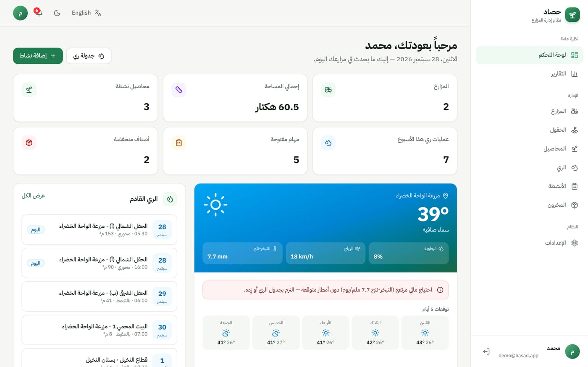

---

## الفهرس

1. [ما هو حصاد؟](#ما-هو-حصاد)
2. [تشغيل البرنامج لأول مرة](#تشغيل-البرنامج-لأول-مرة)
3. [الفكرة الأساسية: ترتيب إدخال البيانات](#الفكرة-الأساسية-ترتيب-إدخال-البيانات)
4. [دليل الاستخدام صفحة بصفحة](#دليل-الاستخدام-صفحة-بصفحة)
5. [أدوات مشتركة في كل الصفحات](#أدوات-مشتركة-في-كل-الصفحات)
6. [يوم عمل نموذجي في حصاد](#يوم-عمل-نموذجي-في-حصاد)
7. [الاستخدام على الجوال](#الاستخدام-على-الجوال)
8. [أسئلة شائعة وحل المشاكل](#أسئلة-شائعة-وحل-المشاكل)
9. [للمطورين: التقنيات وهيكل المشروع](#للمطورين-التقنيات-وهيكل-المشروع)

---

## ما هو حصاد؟

حصاد نظام معلومات زراعي يجمع كل بيانات المزرعة في مكان واحد:

| الوحدة | ماذا تفعل |
|---|---|
| 🚜 **المزارع والحقول** | تسجيل المزارع ومواقعها ومساحاتها، وتقسيمها إلى حقول مع نوع التربة ونظام الري |
| 🌱 **المحاصيل** | الصنف، تاريخ الزراعة والحصاد، نسبة تقدم النمو، والإنتاج المتوقع والفعلي |
| 💧 **الري** | جدولة الري لكل حقل (التاريخ، الوقت، المدة، كمية المياه، الطريقة) وتحديده كمنجز |
| 📋 **الأنشطة** | الحراثة، التسميد، الرش، الحصاد… مع الأولوية والحالة والمسؤول والتكلفة |
| 📦 **المخزون** | البذور والأسمدة والمبيدات والوقود مع تنبيه عند انخفاض الكمية |
| ☀️ **الطقس** | طقس مباشر لكل مزرعة + توصية ري ذكية مبنية على التبخر-نتح (ET₀) |
| 📊 **التقارير** | رسوم بيانية للتكاليف والمياه والإنتاج، مع الطباعة والتصدير إلى Excel (CSV) |

---

## تشغيل البرنامج لأول مرة

البرنامج **لا يحتاج قاعدة بيانات ولا أي إعدادات**. كل البيانات تُحفظ في المتصفح، وتبدأ ببيانات مزرعة تجريبية جاهزة من ملف seed.

### المتطلبات
- **Node.js** إصدار 20.9 أو أحدث — [nodejs.org](https://nodejs.org)

### التشغيل
افتح الطرفية (Terminal) داخل مجلد `agri-farm-system` ونفّذ مرة واحدة فقط:

```bash
npm install
```

ثم في كل مرة تريد تشغيل البرنامج:

```bash
npm run dev
```

افتح المتصفح على **http://localhost:3000** 🎉

### الدخول بالحساب التجريبي
في صفحة تسجيل الدخول اضغط **"الدخول بالحساب التجريبي"** — أو اكتب:

| البريد الإلكتروني | كلمة المرور |
|---|---|
| `demo@hasad.app` | `hasad2026` |

الحساب التجريبي يحتوي مسبقاً على مزرعتين مع الحقول والمحاصيل وجداول الري والأنشطة والمخزون، فتجد بيانات في كل الصفحات.

> 💾 **أين تُحفظ البيانات؟** في التخزين المحلي للمتصفح (`localStorage`). تبقى تعديلاتك بعد إغلاق المتصفح، لكنها خاصة بهذا المتصفح فقط — أي متصفح أو جهاز آخر يبدأ من البيانات التجريبية من جديد. البيانات الأولية موجودة في الملف [`src/data/seed.ts`](src/data/seed.ts).

---

## الفكرة الأساسية: ترتيب إدخال البيانات

البيانات في حصاد مرتبطة ببعضها، لذلك أدخلها بهذا الترتيب:

```
المزرعة  ←  الحقل  ←  المحصول / جدول الري
   │
   └──────────────←  النشاط (يرتبط بمزرعة، والحقل اختياري)

المخزون مستقل ويمكن إضافته في أي وقت
```

- لا يمكن إضافة **حقل** قبل وجود **مزرعة** (سيظهر لك تنبيه أصفر وزر الإضافة معطّل).
- لا يمكن إضافة **محصول** أو **جدول ري** قبل وجود **حقل**.
- عند **حذف مزرعة** تُحذف معها كل حقولها ومحاصيلها وجداول الري والأنشطة التابعة لها.

> ⚡ **أسرع طريقة للتجربة:** ادخل **بالحساب التجريبي** — فيه بيانات جاهزة. أما الحساب الجديد فيبدأ فارغاً، ويمكنك الضغط على **"تحميل بيانات تجريبية"** في لوحة التحكم لإضافة المزارع التجريبية.

---

## دليل الاستخدام صفحة بصفحة

### 1. الصفحة الرئيسية
أول صفحة تظهر عند فتح الموقع. تعرّف بالنظام ومميزاته، ومنها تنتقل إلى **ابدأ مجاناً** (إنشاء حساب) أو **تسجيل الدخول**. في الأعلى أزرار تغيير **اللغة** و**المظهر (فاتح/داكن)**.

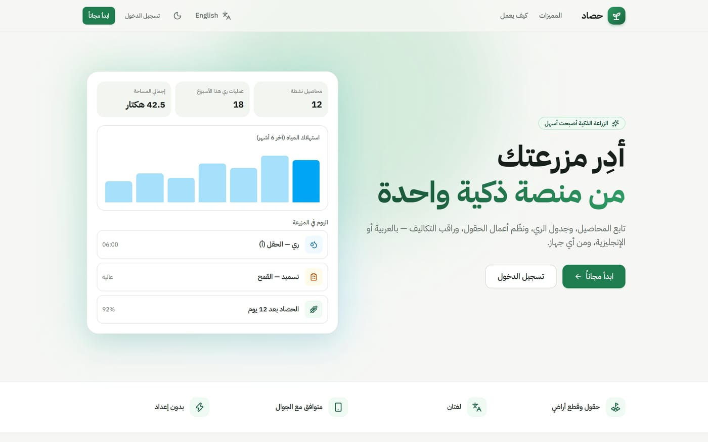

### 2. تسجيل الدخول وإنشاء حساب

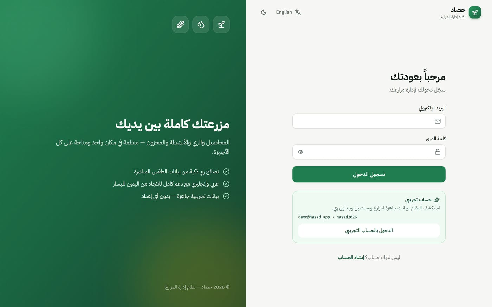

- **الحساب التجريبي:** المربع الأخضر في صفحة الدخول يدخلك بنقرة واحدة (`demo@hasad.app` / `hasad2026`).
- **إنشاء حساب:** أدخل الاسم الكامل، البريد الإلكتروني، رقم الجوال (اختياري)، وكلمة مرور لا تقل عن **8 أحرف** مرتين. الحساب الجديد يبدأ بدون بيانات.
- **تسجيل الدخول:** البريد + كلمة المرور. أيقونة 👁 تُظهر كلمة المرور.
- **تسجيل الخروج:** من أيقونة الخروج أسفل القائمة الجانبية، أو من صورة الحساب أعلى الصفحة.

> الحسابات والبيانات محفوظة في هذا المتصفح، وكل حساب يرى مزارعه فقط.

### 3. لوحة التحكم


أول ما تراه بعد الدخول، وتعطيك صورة كاملة عن المزرعة اليوم:

| القسم | الشرح |
|---|---|
| **البطاقات العلوية** | عدد المزارع، إجمالي المساحة، المحاصيل النشطة، عمليات الري هذا الأسبوع، المهام المفتوحة، الأصناف المنخفضة في المخزون |
| **بطاقة الطقس** | الحرارة والرطوبة والرياح والتبخر-نتح لأول مزرعة لها إحداثيات، مع توقعات 5 أيام |
| **توصية الري** | رسالة ملونة تنصحك بتأجيل أو الالتزام أو تقليل الري (انظر الجدول بالأسفل) |
| **الري القادم** | أقرب 5 عمليات ري مجدولة، وعليها شارة **"اليوم"** إن كانت اليوم |
| **الرسوم البيانية** | تكاليف الأنشطة واستهلاك المياه لآخر 6 أشهر (مرّر الماوس على العمود لرؤية القيمة) |
| **المهام القادمة** | المهام غير المنجزة، والمتأخرة منها عليها شارة حمراء **"متأخرة"** |
| **حصاد قريب** | المحاصيل التي اقترب موعد حصادها |

الزران **"جدولة ري"** و**"إضافة نشاط"** أعلى الصفحة يفتحان نموذج الإضافة مباشرة.

**كيف تعمل توصية الري؟** يعتمد النظام على توقعات الأمطار ومعدل **التبخر-نتح المرجعي (ET₀)** من خدمة Open-Meteo:

| الحالة | التوصية |
|---|---|
| 🌧️ أمطار ≥ 5 ملم خلال 48 ساعة | تأجيل الري |
| 🔴 ET₀ ≥ 6 ملم/يوم | احتياج مرتفع — التزم بالجدول أو زِد الري |
| 🟡 ET₀ بين 3 و 6 | احتياج متوسط — خطة الري المعتادة |
| 🟢 ET₀ أقل من 3 | احتياج منخفض — يمكن تقليل الري |

> إذا ظهرت رسالة *"أضف إحداثيات المزرعة"* بدل الطقس، عدّل المزرعة وأضف خط العرض وخط الطول (أو اضغط **استخدام موقعي الحالي**).

### 4. المزارع

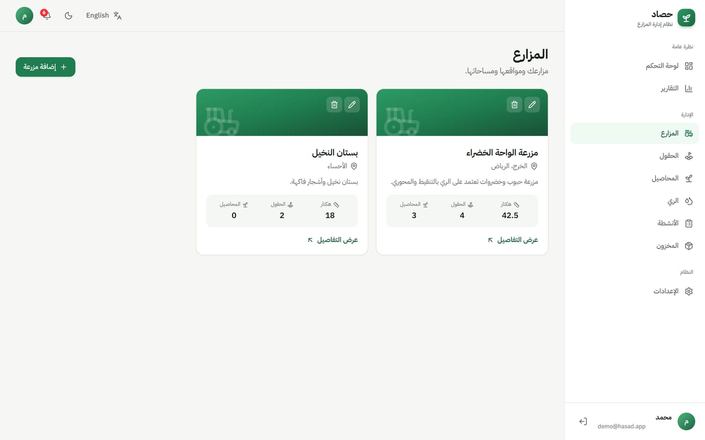

- **إضافة مزرعة:** زر **"إضافة مزرعة"** ← أدخل:
  - **اسم المزرعة** (مطلوب)، **الموقع** (مثل: الخرج، الرياض)، **المساحة** بالهكتار، **الوصف**.
  - **خط العرض / خط الطول**: لتفعيل الطقس. يمكنك الضغط على **"استخدام موقعي الحالي"** إذا كنت في المزرعة، أو تركها فارغة وسيحاول النظام تحديدها تلقائياً من اسم الموقع.
- كل بطاقة تعرض المساحة وعدد الحقول والمحاصيل النشطة.
- أيقونة ✏️ للتعديل، وأيقونة 🗑 للحذف (مع رسالة تأكيد).
- **عرض التفاصيل** يفتح صفحة المزرعة:

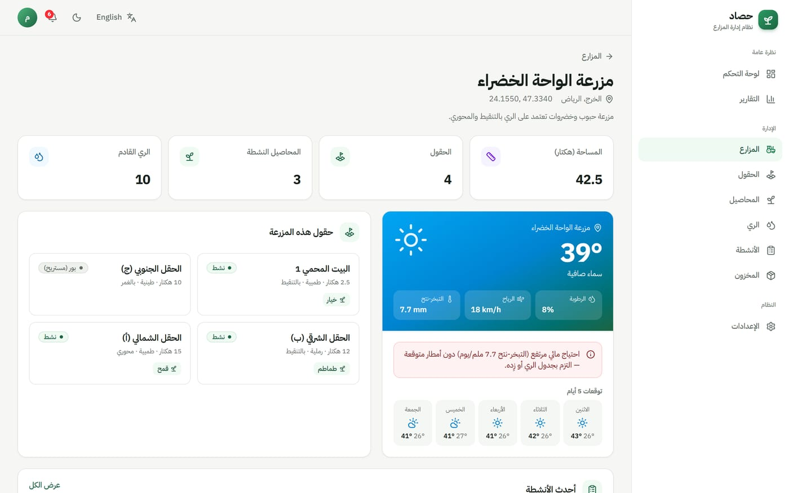

صفحة التفاصيل تعرض الطقس الخاص بالمزرعة، وحقولها مع المحاصيل المزروعة في كل حقل، وأحدث أنشطتها.

### 5. الحقول

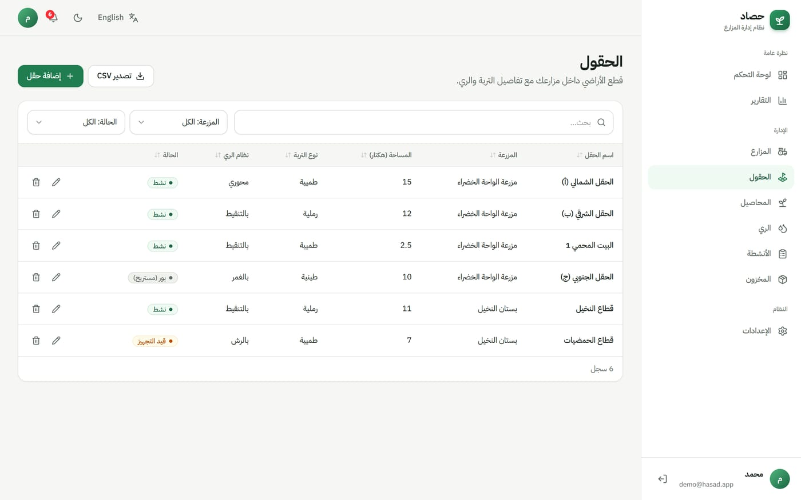

الحقل هو قطعة أرض داخل المزرعة. عند الإضافة:

| الحقل | الشرح |
|---|---|
| اسم الحقل \* | مثل: الحقل الشمالي (أ) |
| المزرعة \* | المزرعة التي يتبع لها |
| المساحة | بالهكتار |
| الحالة \* | نشط / بور (مستريح) / قيد التجهيز |
| نوع التربة | طينية، رملية، طميية… |
| نظام الري | بالتنقيط، بالرش، بالغمر، محوري، يدوي |

### 6. المحاصيل

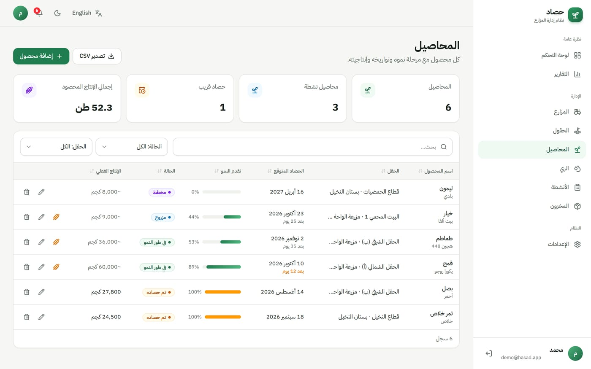

| الحقل | الشرح |
|---|---|
| اسم المحصول \* / الصنف | مثل: قمح — يكورا روجو |
| الحقل \* | أين زُرع |
| تاريخ الزراعة / الحصاد المتوقع | يجب أن يكون الحصاد بعد الزراعة |
| الحالة \* | مخطط، مزروع، في طور النمو، تم حصاده، تالف |
| الإنتاج المتوقع / الفعلي + الوحدة | بالكيلوجرام أو الطن |

- **تقدم النمو** يُحسب تلقائياً من تاريخ الزراعة والحصاد المتوقع.
- تحت تاريخ الحصاد يظهر **"بعد X يوم"**، ويتحول للون البرتقالي إذا بقي 14 يوماً أو أقل.
- أيقونة 🌾 بجانب المحصول النشط تحدده **"تم حصاده"** بنقرة واحدة وتسجل تاريخ اليوم.

### 7. الري

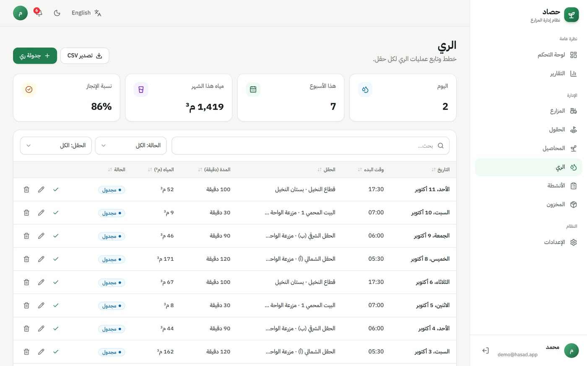

- **جدولة ري:** اختر الحقل، التاريخ، وقت البدء، المدة بالدقائق، كمية المياه (م³)، طريقة الري، والحالة.

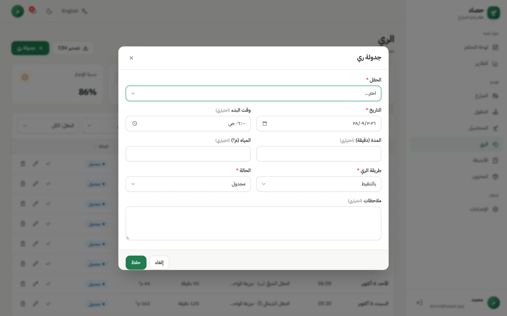

- بعد تنفيذ الري اضغط ✓ **"تحديد كمنجز"** بجانب العملية.
- الشارات: **"اليوم"** للعمليات المجدولة اليوم، **"متأخرة"** للعمليات التي فات موعدها ولم تُنجز.
- البطاقات العلوية: عمليات اليوم، عمليات الأسبوع، المياه المستهلكة هذا الشهر، ونسبة الإنجاز.

### 8. الأنشطة

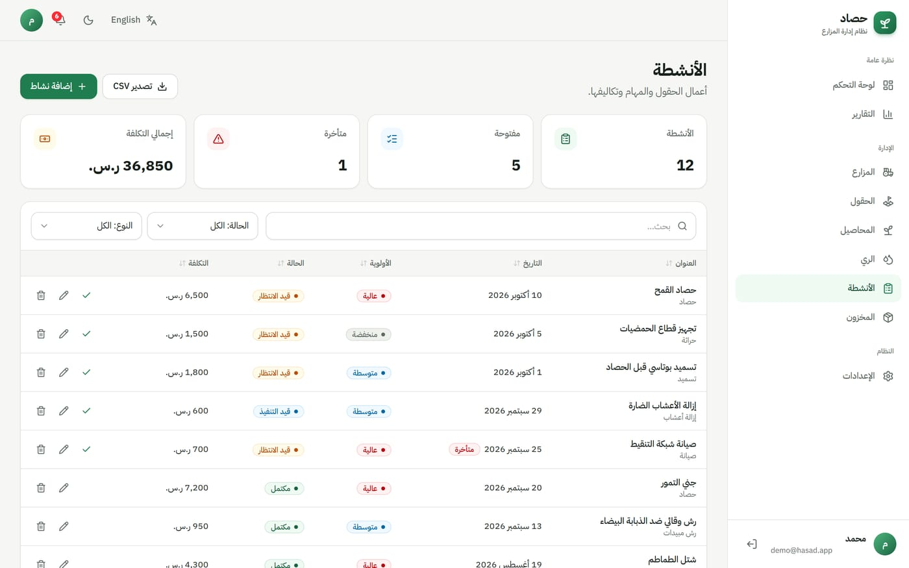

كل عمل في المزرعة (حراثة، زراعة، تسميد، رش مبيدات، إزالة أعشاب، تقليم، حصاد، صيانة):

| الحقل | الشرح |
|---|---|
| العنوان \* والنوع \* | مثل: تسميد نيتروجيني — تسميد |
| التاريخ \* | موعد التنفيذ |
| المزرعة \* / الحقل | عند اختيار المزرعة تظهر حقولها فقط |
| الأولوية \* | منخفضة / متوسطة / عالية |
| الحالة \* | قيد الانتظار، قيد التنفيذ، مكتمل، ملغي |
| التكلفة | بالعملة المختارة في الإعدادات |
| المسؤول | اسم العامل أو المهندس |

- المهام التي فات تاريخها ولم تكتمل تظهر عليها شارة **"متأخرة"** وتدخل في الإشعارات.
- زر ✓ يحدد المهمة **"مكتمل"** مباشرة.

### 9. المخزون

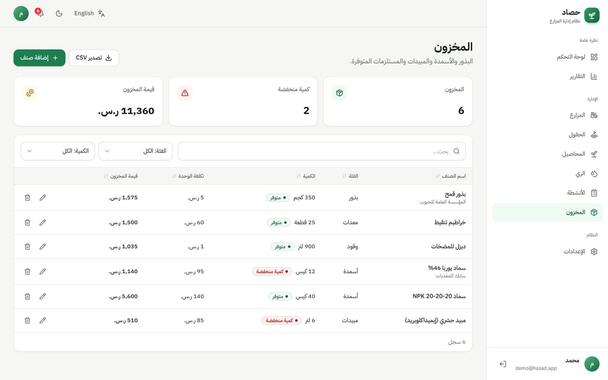

- أضف الصنف مع **الفئة** والكمية والوحدة و**الحد الأدنى** وتكلفة الوحدة والمورد.
- إذا وصلت الكمية إلى الحد الأدنى أو أقل تظهر شارة حمراء **"كمية منخفضة"** وتنبيه في الإشعارات.
- **قيمة المخزون** = الكمية × تكلفة الوحدة.

### 10. التقارير

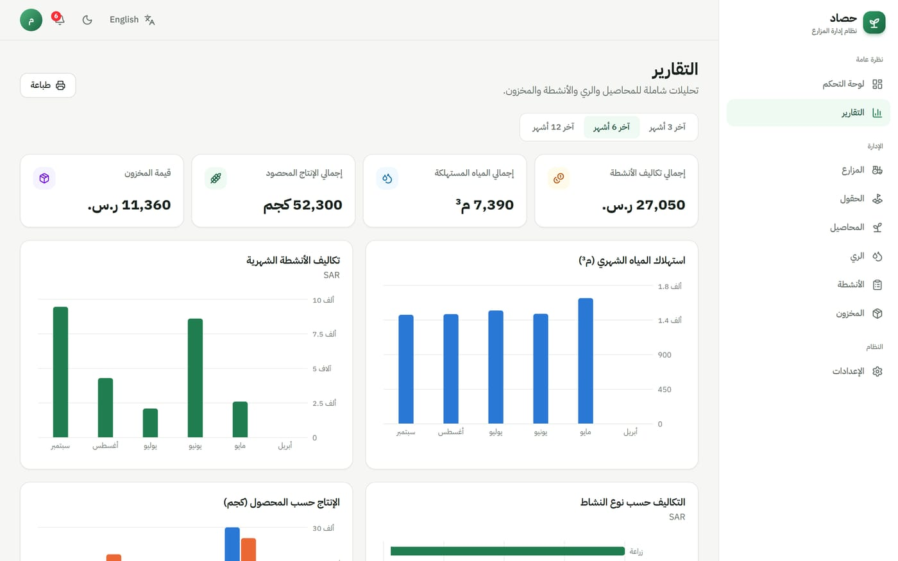

- اختر الفترة: **آخر 3 / 6 / 12 شهر**.
- الملخص: إجمالي التكاليف، المياه المستهلكة، الإنتاج المحصود، قيمة المخزون.
- الرسوم: المياه الشهرية، التكاليف الشهرية، التكاليف حسب نوع النشاط، الإنتاج المتوقع مقابل الفعلي، المحاصيل حسب الحالة، المهام حسب الحالة، قيمة المخزون حسب الفئة.
- زر **طباعة** — لحفظ التقرير كملف PDF اختر *Save as PDF / حفظ كـ PDF* من نافذة الطباعة.

### 11. الإعدادات

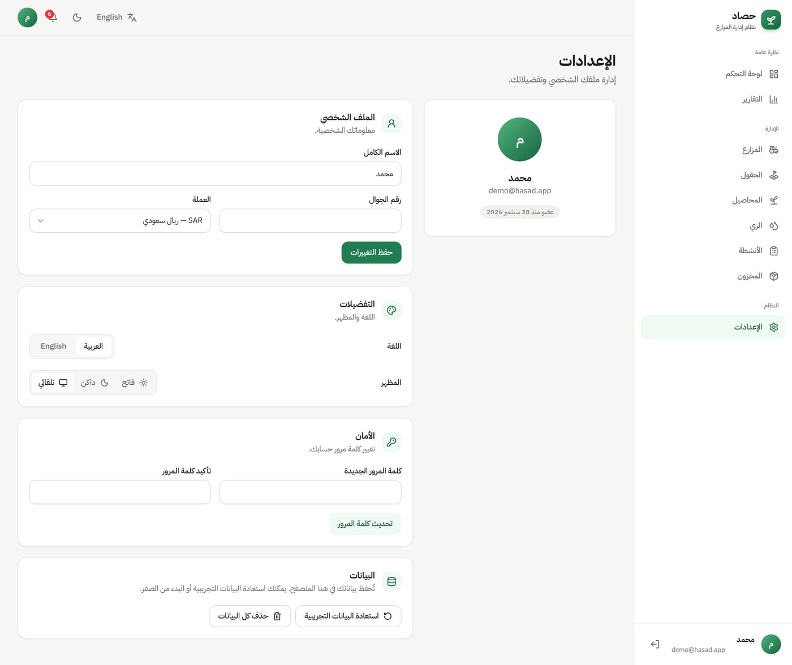

- **الملف الشخصي:** الاسم، الجوال، و**العملة** (ريال سعودي، درهم، دينار، دولار…) — تتغير العملة في كل الصفحات.
- **التفضيلات:** اللغة (العربية / English) والمظهر (فاتح / داكن / تلقائي).
- **الأمان:** تغيير كلمة المرور.
- **البيانات:** **استعادة البيانات التجريبية** (استبدال كل شيء بنسخة جديدة من بيانات seed) أو **حذف كل البيانات** (البدء من الصفر). الخياران يطلبان تأكيداً.

### 12. الإشعارات 🔔
أيقونة الجرس أعلى الصفحة، والرقم الأحمر عليها هو عدد التنبيهات. عند الضغط تظهر:
- عمليات الري المجدولة **اليوم**
- المهام **المتأخرة**
- أصناف المخزون **المنخفضة**
- المحاصيل التي **سيُحصد** خلال 14 يوماً

اضغط على أي تنبيه للانتقال إلى الصفحة الخاصة به.

---

## أدوات مشتركة في كل الصفحات

| الأداة | طريقة الاستخدام |
|---|---|
| ➕ **إضافة** | الزر الأخضر أعلى الصفحة يفتح نموذج الإضافة. الحقول التي عليها \* مطلوبة |
| 🔍 **بحث** | اكتب أي كلمة أو رقم للبحث في كل الأعمدة |
| 🔽 **فلترة** | القوائم بجانب البحث (مثل: الحالة، الحقل، النوع) |
| ↕️ **ترتيب** | اضغط على عنوان أي عمود للترتيب تصاعدياً/تنازلياً |
| ✏️ **تعديل** | أيقونة القلم بجانب السجل |
| 🗑 **حذف** | أيقونة السلة — يطلب تأكيداً قبل الحذف |
| ✓ **منجز** | في الري والأنشطة (و🌾 في المحاصيل) |
| ⬇️ **تصدير CSV** | ينزّل البيانات الظاهرة كملف يفتح في Excel |
| 📄 **الصفحات** | أسفل الجدول، 10 سجلات في كل صفحة |
| 🌐 / 🌙 | تغيير اللغة والمظهر من الشريط العلوي في أي وقت |

---

## يوم عمل نموذجي في حصاد

1. **الصباح:** افتح لوحة التحكم ← اقرأ **توصية الري** وتحقق من **الري القادم** و🔔 الإشعارات.
2. **في الحقل:** بعد تنفيذ الري اضغط ✓ على العملية من الجوال.
3. **خلال اليوم:** أنهِ المهام وحدّد كل مهمة كمكتملة، وسجّل تكلفتها.
4. **عند الشراء:** حدّث كميات المخزون (بذور، أسمدة، وقود).
5. **عند الحصاد:** اضغط 🌾 على المحصول، ثم عدّله وأدخل **الإنتاج الفعلي**.
6. **نهاية الشهر:** افتح **التقارير**، راجع التكاليف والمياه والإنتاج، واطبع التقرير.

---

## الاستخدام على الجوال

الموقع مصمم للجوال ولا يحتاج تطبيق — افتح الرابط من متصفح الجوال (ويمكنك إضافته للشاشة الرئيسية).

<p align="center">
  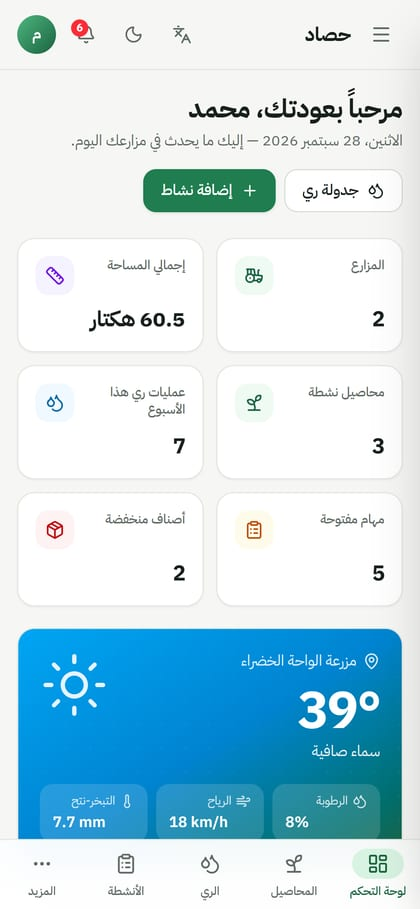
  &nbsp;
  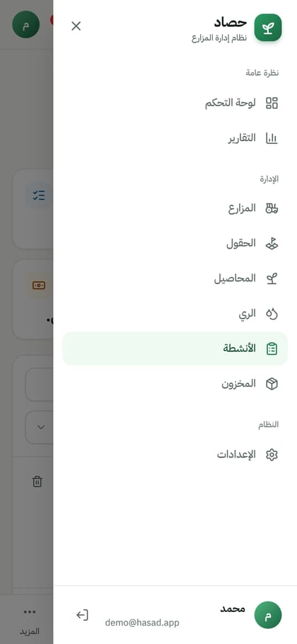
  &nbsp;
  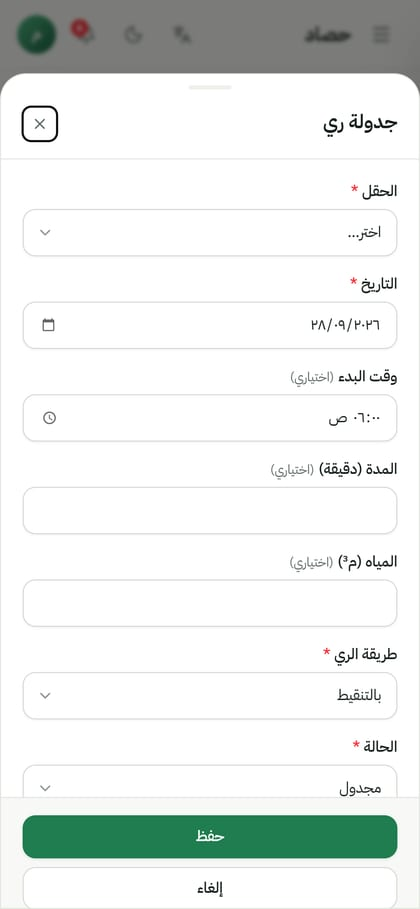
</p>

- **الشريط السفلي:** لوحة التحكم، المحاصيل، الري، الأنشطة، و**المزيد** لفتح القائمة الكاملة.
- **القائمة ☰** أعلى الصفحة تفتح كل الأقسام وتسجيل الخروج.
- الجداول تتحول إلى **بطاقات** سهلة القراءة، والنماذج تفتح من **أسفل الشاشة**.

**الوضع الداكن:**

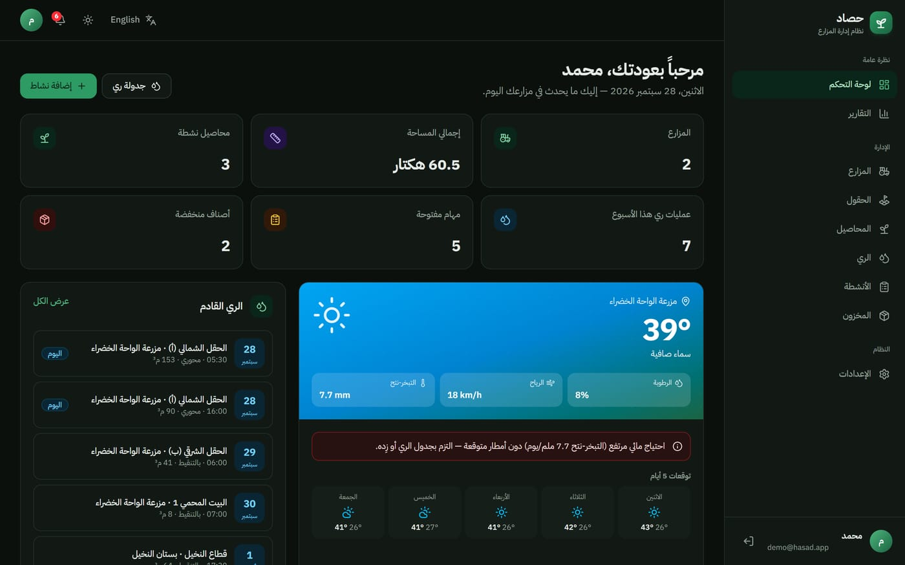

---

## أسئلة شائعة وحل المشاكل

<details>
<summary><b>هل أحتاج قاعدة بيانات أو أي إعدادات؟</b></summary>

لا. نفّذ `npm install` مرة واحدة ثم `npm run dev`، وادخل بالحساب التجريبي. كل شيء محفوظ في المتصفح.
</details>

<details>
<summary><b>اختفت بياناتي</b></summary>

البيانات تُحفظ لكل متصفح على حدة. إذا فتحت الموقع من متصفح آخر أو جهاز آخر أو نافذة خاصة، أو بعد مسح بيانات الموقع من المتصفح، ستبدأ من البيانات التجريبية من جديد. استخدم نفس المتصفح للاحتفاظ بتعديلاتك.
</details>

<details>
<summary><b>كيف أرجع للبيانات التجريبية الأصلية؟</b></summary>

من **الإعدادات ← البيانات ← استعادة البيانات التجريبية**.
</details>

<details>
<summary><b>نسيت كلمة مرور حساب أنشأته</b></summary>

الحسابات محفوظة في المتصفح فقط، لذلك لا توجد استعادة عبر البريد. ادخل بالحساب التجريبي أو أنشئ حساباً جديداً.
</details>

<details>
<summary><b>زر "إضافة حقل" أو "إضافة محصول" معطّل</b></summary>

يجب إضافة **مزرعة** قبل الحقول، و**حقل** قبل المحاصيل وجداول الري. اقرأ الرسالة الصفراء أعلى الجدول.
</details>

<details>
<summary><b>لا يظهر الطقس في لوحة التحكم</b></summary>

الطقس يحتاج اتصالاً بالإنترنت. وتأكد أن للمزرعة **خط عرض** و**خط طول** (عدّل المزرعة أو اضغط **استخدام موقعي الحالي**).
</details>

<details>
<summary><b>ظهرت رسالة "حدث خطأ ما" عند الحفظ</b></summary>

تأكد من تعبئة الحقول المطلوبة (\*)، وأن تاريخ الحصاد المتوقع بعد تاريخ الزراعة.
</details>

<details>
<summary><b>كيف أغير اسم الطالب أو الجامعة في أسفل الصفحة الرئيسية؟</b></summary>

من الملف [`src/lib/site.ts`](src/lib/site.ts).
</details>

---

## للمطورين: التقنيات وهيكل المشروع

### التقنيات
- **Next.js 16** (App Router, Server Components, Server Actions, `proxy.ts`) + **React 19** + **TypeScript**
- **بدون قاعدة بيانات:** مخزن بيانات صغير في المتصفح (`localStorage`) مع بيانات seed
- **Tailwind CSS 4**, **Recharts**, **lucide-react**, **zod**, **sonner**, **next-themes**
- **Open-Meteo** للطقس وتحديد الإحداثيات (مجاني وبدون مفتاح)

### الأوامر

| الأمر | الوصف |
|---|---|
| `npm run dev` | تشغيل وضع التطوير على المنفذ 3000 |
| `npm run build` | بناء نسخة الإنتاج |
| `npm start` | تشغيل نسخة الإنتاج |
| `npm run lint` | فحص الشيفرة |

### هيكل المشروع

```
docs/                        ← صور الدليل (en / ar) والعروض التقديمية
src/
├─ proxy.ts                  ← حماية /dashboard (تحويل لتسجيل الدخول عند الخروج)
├─ data/seed.ts              ← البيانات التجريبية (مزارع، حقول، محاصيل، ري، أنشطة، مخزون)
├─ app/
│  ├─ page.tsx               ← الصفحة الرئيسية
│  ├─ (auth)/                ← تسجيل الدخول وإنشاء حساب
│  └─ dashboard/             ← لوحة التحكم وكل صفحات الإدارة والتقارير والإعدادات
├─ components/
│  ├─ ui/                    ← مكونات عامة (Button, Modal, Card, Badge…)
│  ├─ resource/              ← جدول + نموذج CRUD عام (بحث، فلترة، ترتيب، تصدير، بطاقات للجوال)
│  ├─ views/                 ← واجهة كل صفحة (المحاصيل، الري، الأنشطة…)
│  └─ dashboard/             ← القائمة الجانبية، الشريط العلوي، الطقس، الإشعارات
└─ lib/
   ├─ store.ts               ← مخزن البيانات المحلي: الحسابات، الحفظ/الحذف، الحذف المتسلسل، البيانات التجريبية
   ├─ i18n/                  ← القواميس العربية والإنجليزية
   ├─ validations.ts         ← التحقق من المدخلات بـ zod
   ├─ weather.ts             ← الطقس وتوصيات الري (Open-Meteo)
   └─ analytics.ts           ← إحصائيات لوحة التحكم والتقارير
```

### نموذج البيانات

البيانات منظمة مثل جداول قاعدة بيانات علائقية، وتُحفظ في المتصفح تحت مفاتيح `localStorage` (`hasad:users` و `hasad:session` و `hasad:data:<userId>`):

| الجدول | الوصف |
|---|---|
| `users` | الحسابات (الاسم، البريد، الجوال، العملة) — الحساب التجريبي يُنشأ تلقائياً |
| `farms` | المزارع (الموقع، المساحة، الإحداثيات) |
| `fields` | الحقول داخل كل مزرعة (التربة، نظام الري، الحالة) |
| `crops` | المحاصيل في كل حقل (التواريخ، الحالة، الإنتاج) |
| `irrigation_schedules` | جداول الري (التاريخ، الوقت، المدة، المياه، الطريقة، الحالة) |
| `activities` | الأنشطة والمهام (النوع، الأولوية، التكلفة، المسؤول) |
| `inventory_items` | المخزون (الفئة، الكمية، الحد الأدنى، التكلفة) |

**قواعد سلامة البيانات** (مثل قاعدة البيانات): كل المدخلات يتم التحقق منها بـ zod، والحقل يجب أن يتبع مزرعة موجودة، والمحاصيل والري يجب أن تتبع حقلاً موجوداً، وحقل النشاط يجب أن يكون من نفس مزرعته، وحذف المزرعة يحذف حقولها ومحاصيلها وجداول الري والأنشطة التابعة لها.

> الملف `src/lib/store.ts` هو المكان الوحيد الذي يقرأ ويكتب البيانات، لذلك يمكن لاحقاً استبداله بقاعدة بيانات حقيقية (مثل PostgreSQL) دون تغيير الصفحات.

### النشر على الإنترنت (Vercel)
ارفع المشروع إلى GitHub ثم استورده في [vercel.com](https://vercel.com). لا يحتاج أي متغيرات بيئة.

### تخصيص
- البيانات التجريبية: [`src/data/seed.ts`](src/data/seed.ts)
- بريد وكلمة مرور الحساب التجريبي: [`src/lib/session.ts`](src/lib/session.ts)
- اسم الطالب والجامعة والمشرف: [`src/lib/site.ts`](src/lib/site.ts)
- النصوص والترجمات: [`src/lib/i18n/dictionaries/`](src/lib/i18n/dictionaries/)
- الألوان: [`src/app/globals.css`](src/app/globals.css)
