[العربية](README.ar.md) · **English**

# Hasad — Agricultural Farm Management System

A web platform that helps farmers organise crop data, schedule irrigation, and track farm activities, inventory and costs — in Arabic or English, on a computer or a phone.

> **Graduation project** — Prepared by **Mohamad** · Supervised by **Dr. ArunKumar Sivaraman** · **Gulf College**
> Presentation: [`docs/presentation/Hasad_Presentation.pptx`](docs/presentation/Hasad_Presentation.pptx) (English) · [`docs/presentation/Hasad_Presentation_AR.pptx`](docs/presentation/Hasad_Presentation_AR.pptx) (Arabic)

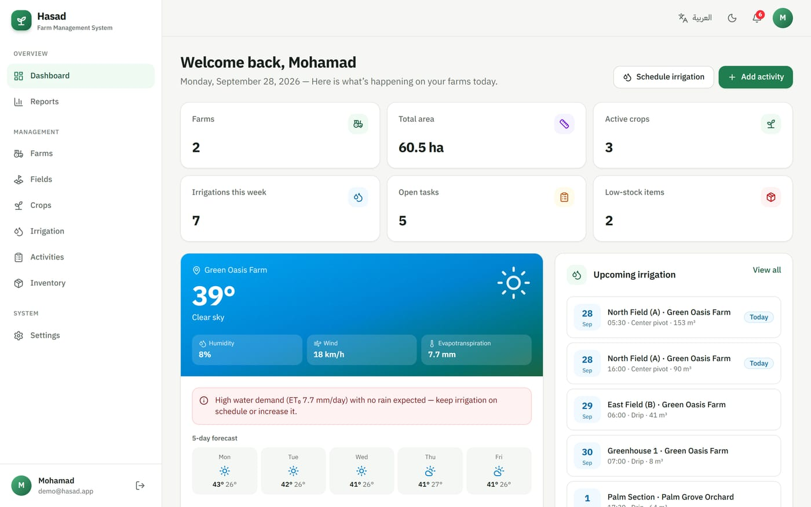

---

## Contents

1. [What is Hasad?](#what-is-hasad)
2. [Running the system for the first time](#running-the-system-for-the-first-time)
3. [The key idea: the order of data entry](#the-key-idea-the-order-of-data-entry)
4. [User guide, page by page](#user-guide-page-by-page)
5. [Tools available on every page](#tools-available-on-every-page)
6. [A typical day with Hasad](#a-typical-day-with-hasad)
7. [Using Hasad on a phone](#using-hasad-on-a-phone)
8. [FAQ & troubleshooting](#faq--troubleshooting)
9. [For developers: technologies & project structure](#for-developers-technologies--project-structure)

---

## What is Hasad?

*Hasad* (حصاد) means "harvest" in Arabic. It is an agricultural information system that brings all farm data into one place:

| Module | What it does |
|---|---|
| 🚜 **Farms & fields** | Record farms with their location and area, and divide them into fields with soil type and irrigation system |
| 🌱 **Crops** | Variety, planting and harvest dates, growth progress, expected and actual yield |
| 💧 **Irrigation** | Schedule irrigation per field (date, time, duration, water volume, method) and mark it as done |
| 📋 **Activities** | Plowing, fertilizing, spraying, harvesting… with priority, status, assignee and cost |
| 📦 **Inventory** | Seeds, fertilizers, pesticides and fuel, with low-stock alerts |
| ☀️ **Weather** | Live weather for each farm + a smart irrigation recommendation based on evapotranspiration (ET₀) |
| 📊 **Reports** | Charts for costs, water use and yield, with printing and export to Excel (CSV) |

---

## Running the system for the first time

Hasad needs **no database and no configuration**. All data is kept in the browser, and a ready-made demo farm is loaded from a seed file.

### Requirements
- **Node.js** version 20.9 or newer — [nodejs.org](https://nodejs.org)

### Run
Open a terminal inside the `agri-farm-system` folder and run this once:

```bash
npm install
```

Then, every time you want to start the system:

```bash
npm run dev
```

Open **http://localhost:3000** in your browser 🎉

### Sign in with the demo account
On the sign-in page, click **"Sign in with the demo account"** — or type:

| Email | Password |
|---|---|
| `demo@hasad.app` | `hasad2026` |

The demo account already contains two farms with fields, crops, irrigation schedules, activities and inventory, so every page has data to explore.

> 💾 **Where is the data saved?** In the browser's local storage (`localStorage`). Your changes are kept after closing the browser, but they belong to that browser only — another browser or device starts from the demo data again. The starting data comes from [`src/data/seed.ts`](src/data/seed.ts).

---

## The key idea: the order of data entry

Data in Hasad is linked together, so enter it in this order:

```
Farm  →  Field  →  Crop / Irrigation schedule
  │
  └──────────────→  Activity (belongs to a farm; the field is optional)

Inventory is independent and can be added at any time
```

- You cannot add a **field** before a **farm** exists (a yellow notice appears and the add button is disabled).
- You cannot add a **crop** or an **irrigation schedule** before a **field** exists.
- **Deleting a farm** also deletes all of its fields, crops, irrigation schedules and activities.

> ⚡ **Fastest way to try it:** sign in with the **demo account** — it already has data. A new account starts empty; click **"Load demo data"** on its dashboard to add the sample farms.

---

## User guide, page by page

### 1. Landing page
The first page of the site. It introduces the system and its features, with buttons to **Start for free** (create an account) or **Sign in**. The top bar has the **language** and **theme (light/dark)** toggles.

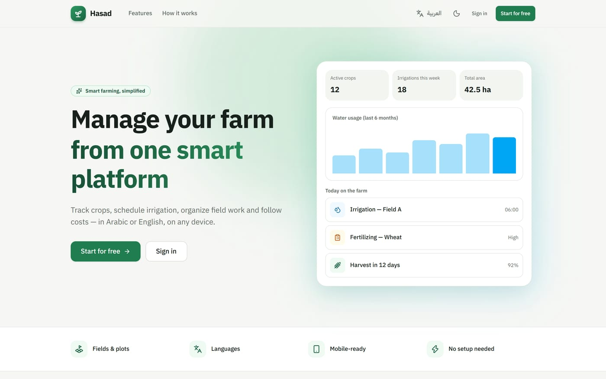

### 2. Signing in and creating an account

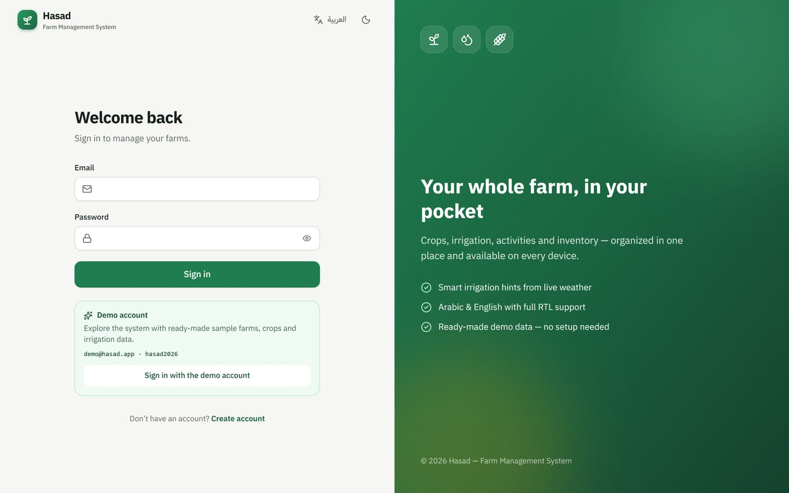

- **Demo account:** the green box on the sign-in page signs you in with one click (`demo@hasad.app` / `hasad2026`).
- **Create account:** enter your full name, email, phone (optional), and a password of at least **8 characters**, twice. A new account starts with no data.
- **Sign in:** email + password. The 👁 icon shows the password.
- **Sign out:** the exit icon at the bottom of the side menu, or from your avatar at the top of the page.

> Accounts and data are stored in this browser. Each account only sees its own farms.

### 3. Dashboard


The first page after signing in. It gives a complete picture of the farm today:

| Section | Description |
|---|---|
| **Top cards** | Number of farms, total area, active crops, irrigations this week, open tasks, low-stock items |
| **Weather card** | Temperature, humidity, wind and evapotranspiration for the first farm with coordinates, plus a 5-day forecast |
| **Irrigation advice** | A coloured message recommending to postpone, keep or reduce irrigation (see the table below) |
| **Upcoming irrigation** | The next 5 scheduled irrigations, with a **"Today"** badge when due today |
| **Charts** | Activity costs and water usage for the last 6 months (hover a bar to see its value) |
| **Upcoming tasks** | Unfinished tasks; overdue ones carry a red **"Overdue"** badge |
| **Harvest soon** | Crops whose harvest date is approaching |

The **"Schedule irrigation"** and **"Add activity"** buttons at the top open the add form directly.

**How does the irrigation advice work?** Hasad uses the rain forecast and the **FAO reference evapotranspiration (ET₀)** from the Open-Meteo service:

| Condition | Recommendation |
|---|---|
| 🌧️ Rain ≥ 5 mm expected within 48 hours | Postpone irrigation |
| 🔴 ET₀ ≥ 6 mm/day | High demand — keep to the schedule or increase |
| 🟡 ET₀ between 3 and 6 | Moderate demand — normal irrigation plan |
| 🟢 ET₀ below 3 | Low demand — irrigation can be reduced |

> If you see *"Add farm coordinates"* instead of the weather, edit the farm and add its latitude and longitude (or click **Use my current location**).

### 4. Farms

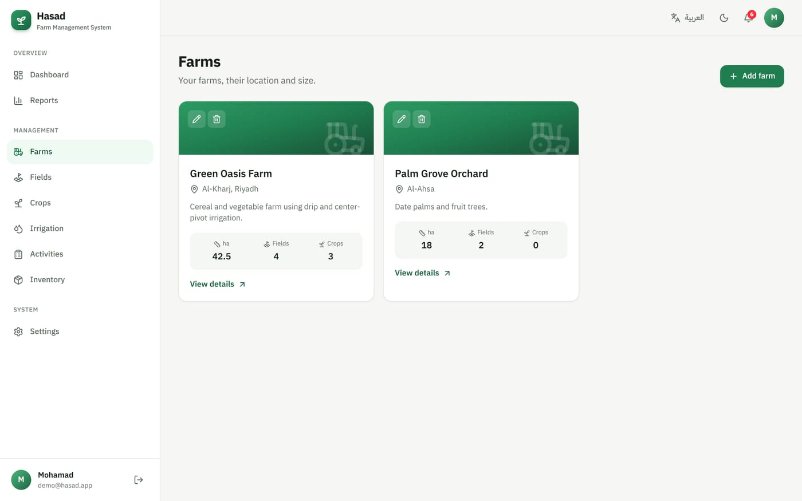

- **Add a farm:** click **"Add farm"** and enter:
  - **Farm name** (required), **Location** (e.g. Al-Kharj, Riyadh), **Area** in hectares, **Description**.
  - **Latitude / Longitude**: needed for the weather. Click **"Use my current location"** if you are at the farm, or leave them empty and Hasad will try to find them from the location name.
- Each card shows the area, number of fields and active crops.
- ✏️ edits the farm, 🗑 deletes it (after a confirmation).
- **View details** opens the farm page:

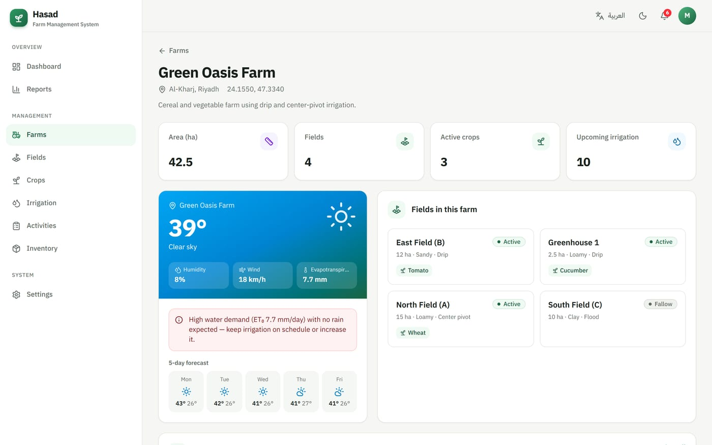

The details page shows the farm's own weather, its fields with the crops planted in each, and its latest activities.

### 5. Fields

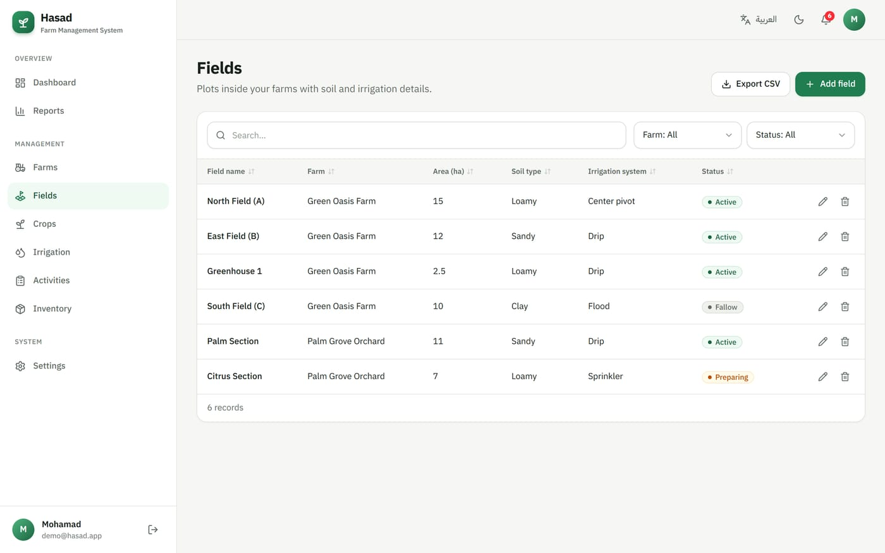

A field is a plot of land inside a farm. When adding one:

| Input | Description |
|---|---|
| Field name \* | e.g. North Field (A) |
| Farm \* | The farm it belongs to |
| Area | In hectares |
| Status \* | Active / Fallow / Preparing |
| Soil type | Clay, sandy, loamy… |
| Irrigation system | Drip, sprinkler, flood, center pivot, manual |

### 6. Crops

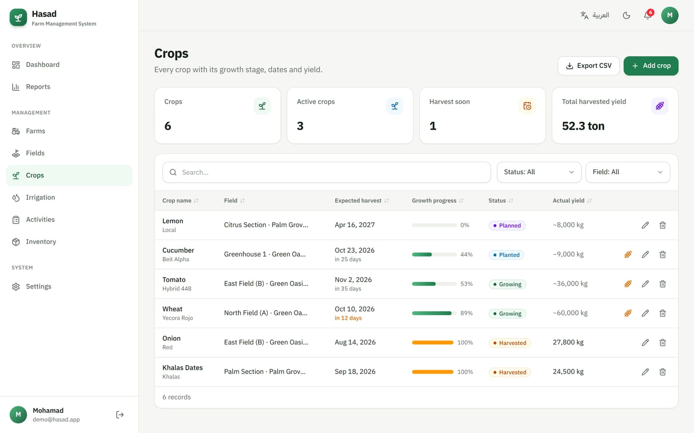

| Input | Description |
|---|---|
| Crop name \* / Variety | e.g. Wheat — Yecora Rojo |
| Field \* | Where it is planted |
| Planting date / Expected harvest | The harvest must be after planting |
| Status \* | Planned, Planted, Growing, Harvested, Failed |
| Expected / actual yield + unit | In kilograms or tons |

- **Growth progress** is calculated automatically from the planting and expected harvest dates.
- Under the harvest date, **"in X days"** appears and turns orange when 14 days or fewer remain.
- The 🌾 icon next to an active crop marks it **"Harvested"** in one click and records today's date.

### 7. Irrigation

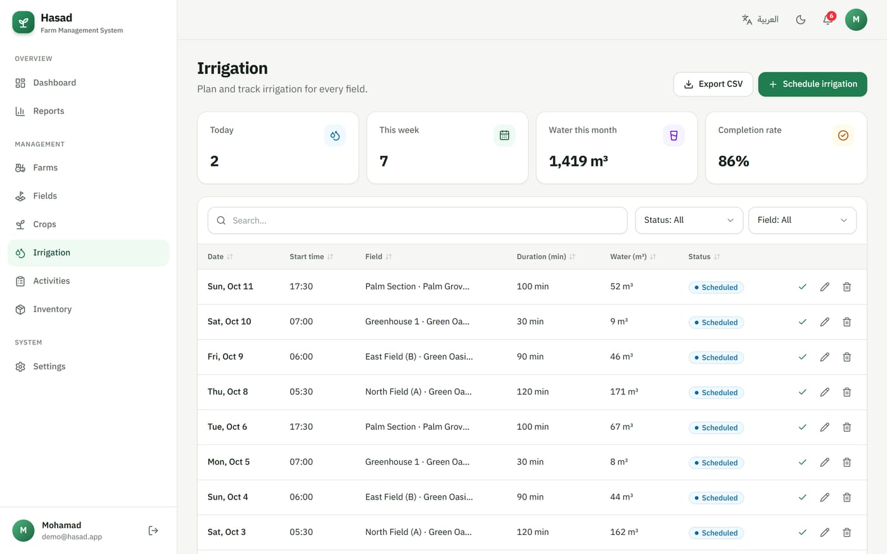

- **Schedule irrigation:** choose the field, date, start time, duration in minutes, water volume (m³), irrigation method and status.

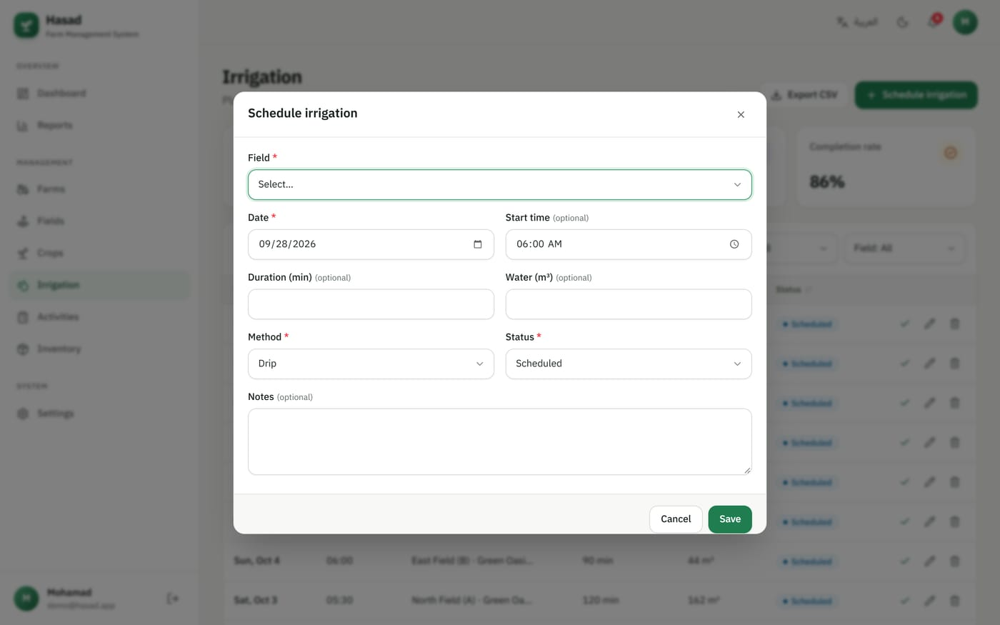

- After watering, click ✓ **"Mark as done"** next to the entry.
- Badges: **"Today"** for irrigations due today, **"Overdue"** for scheduled irrigations whose date has passed.
- Top cards: today's irrigations, this week's, water used this month, and the completion rate.

### 8. Activities

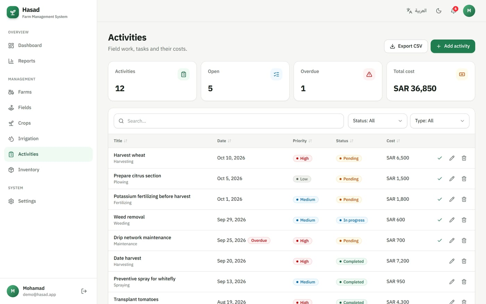

Every job on the farm (plowing, planting, fertilizing, spraying, weeding, pruning, harvesting, maintenance):

| Input | Description |
|---|---|
| Title \* and Type \* | e.g. Nitrogen fertilizing — Fertilizing |
| Date \* | When it should be done |
| Farm \* / Field | After choosing a farm, only its fields are listed |
| Priority \* | Low / Medium / High |
| Status \* | Pending, In progress, Completed, Cancelled |
| Cost | In the currency chosen in Settings |
| Assigned to | The worker or engineer responsible |

- Tasks past their date and not completed get an **"Overdue"** badge and appear in the notifications.
- The ✓ button marks a task as **"Completed"** directly.

### 9. Inventory

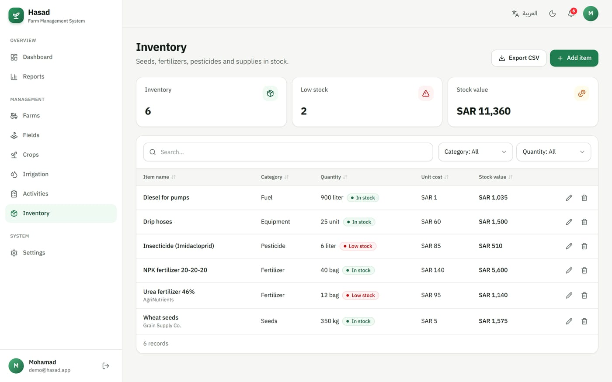

- Add an item with its **category**, quantity, unit, **minimum quantity**, unit cost and supplier.
- When the quantity reaches the minimum or below, a red **"Low stock"** badge appears, along with an alert in the notifications.
- **Stock value** = quantity × unit cost.

### 10. Reports

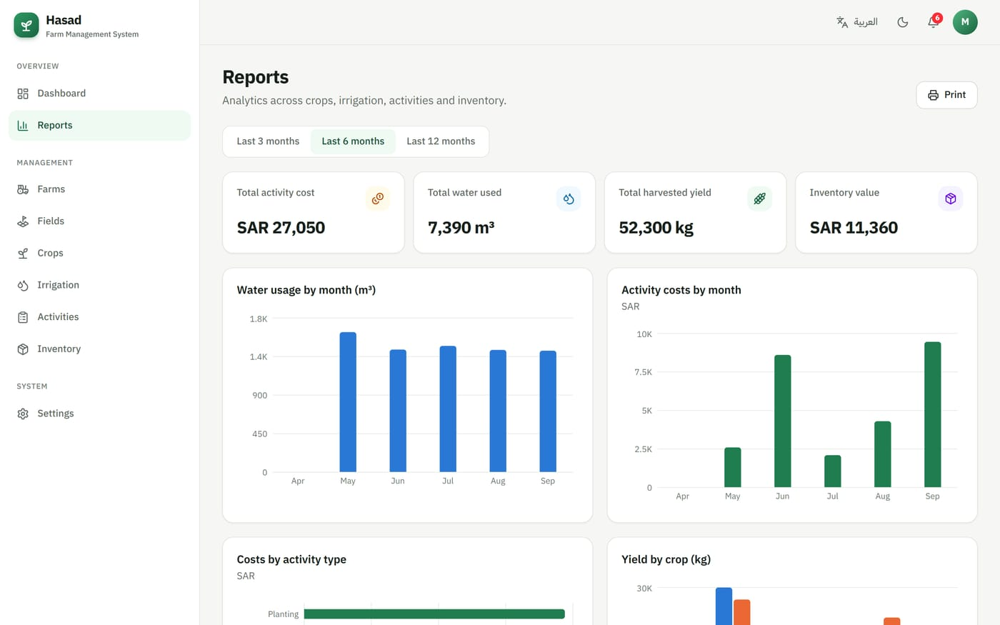

- Choose the period: **last 3 / 6 / 12 months**.
- Summary: total costs, water used, harvested yield, inventory value.
- Charts: monthly water, monthly costs, costs by activity type, expected vs. actual yield, crops by status, tasks by status, inventory value by category.
- **Print** button — to save the report as a PDF, choose *Save as PDF* in the print dialog.

### 11. Settings

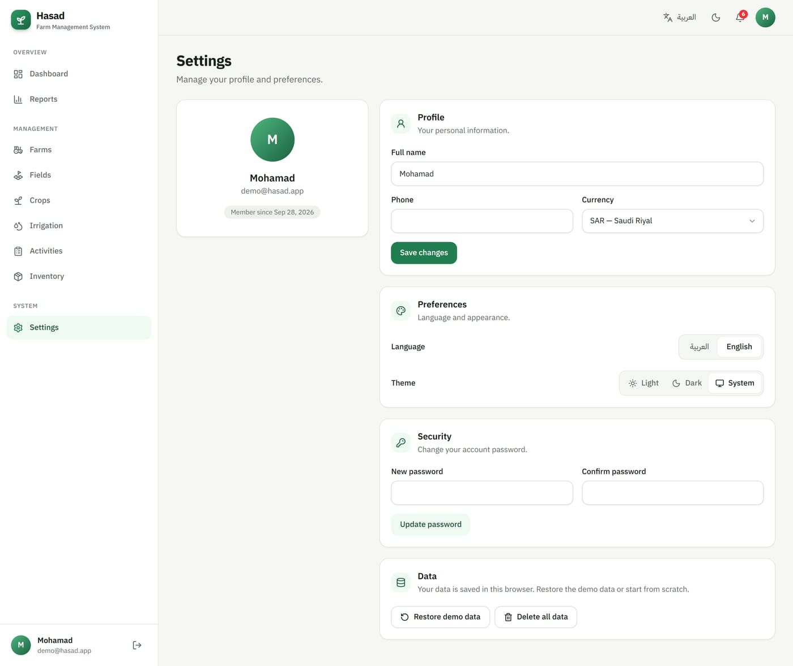

- **Profile:** name, phone and **currency** (SAR, AED, KWD, USD…) — the currency changes on every page.
- **Preferences:** language (العربية / English) and theme (light / dark / system).
- **Security:** change your password.
- **Data:** **Restore demo data** (replace everything with a fresh copy of the seed data) or **Delete all data** (start from scratch). Both ask for confirmation.

### 12. Notifications 🔔
The bell icon at the top of the page; the red number is the count of alerts. Clicking it shows:
- Irrigations scheduled for **today**
- **Overdue** tasks
- **Low-stock** inventory items
- Crops to be **harvested** within 14 days

Click any alert to go to the related page.

---

## Tools available on every page

| Tool | How to use it |
|---|---|
| ➕ **Add** | The green button at the top opens the add form. Fields marked \* are required |
| 🔍 **Search** | Type any word or number to search across all columns |
| 🔽 **Filters** | The drop-downs next to the search box (e.g. status, field, type) |
| ↕️ **Sort** | Click any column header to sort ascending/descending |
| ✏️ **Edit** | The pencil icon next to a record |
| 🗑 **Delete** | The bin icon — asks for confirmation first |
| ✓ **Done** | In Irrigation and Activities (🌾 in Crops) |
| ⬇️ **Export CSV** | Downloads the visible data as a file that opens in Excel |
| 📄 **Pages** | Below the table, 10 records per page |
| 🌐 / 🌙 | Switch language and theme from the top bar at any time |

---

## A typical day with Hasad

1. **Morning:** open the dashboard → read the **irrigation advice**, check **upcoming irrigation** and the 🔔 notifications.
2. **In the field:** after watering, tap ✓ on the irrigation entry from your phone.
3. **During the day:** finish tasks, mark each one as completed and record its cost.
4. **When buying supplies:** update inventory quantities (seeds, fertilizer, fuel).
5. **At harvest:** tap 🌾 on the crop, then edit it and enter the **actual yield**.
6. **End of the month:** open **Reports**, review costs, water and yield, and print the report.

---

## Using Hasad on a phone

The site is designed for phones and needs no app — open the link in your phone's browser (you can add it to your home screen).

<p align="center">
  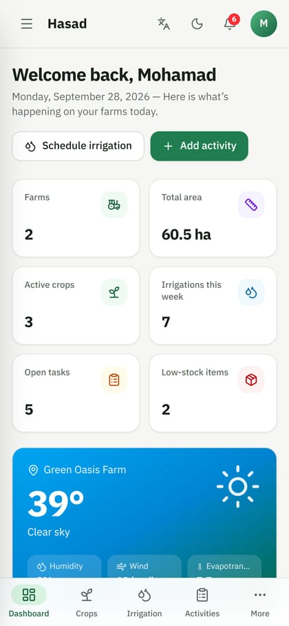
  &nbsp;
  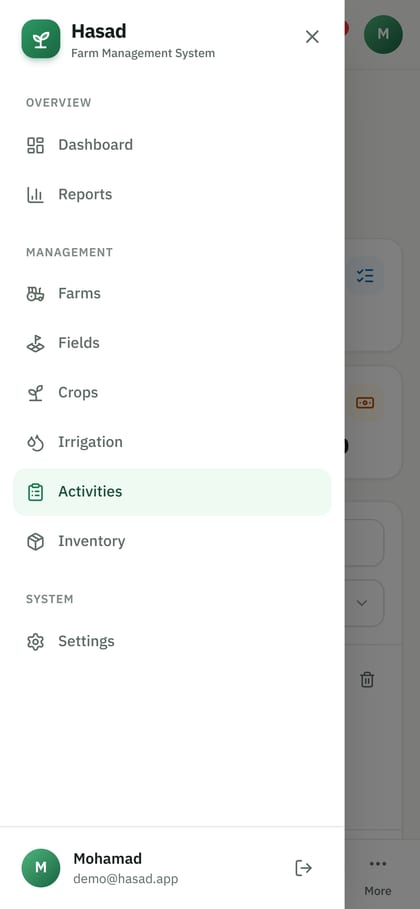
  &nbsp;
  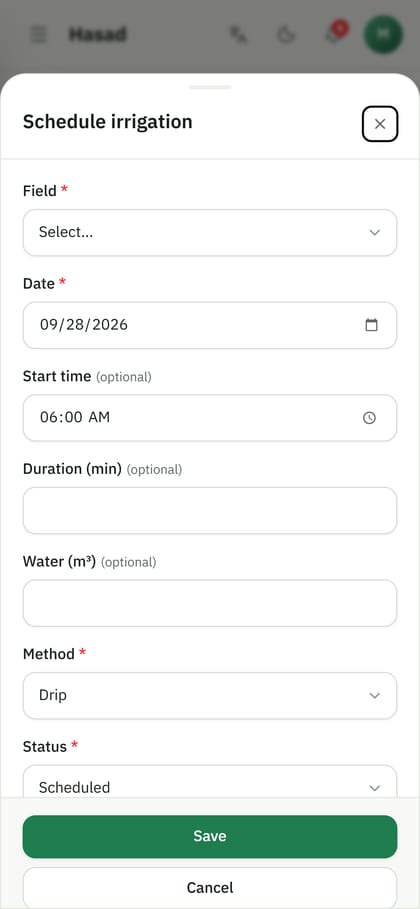
</p>

- **Bottom bar:** Dashboard, Crops, Irrigation, Activities, and **More** to open the full menu.
- **The ☰ menu** at the top opens every section and the sign-out button.
- Tables turn into easy-to-read **cards**, and forms slide up from the **bottom of the screen**.

**Dark mode:**

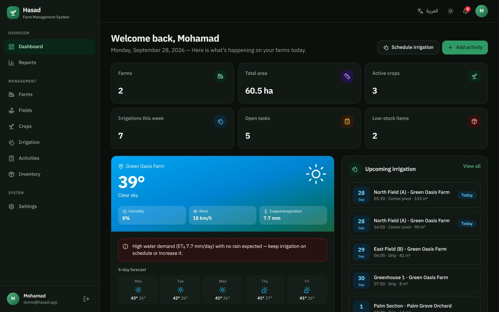

---

## FAQ & troubleshooting

<details>
<summary><b>Do I need a database or any setup?</b></summary>

No. Run `npm install` once and `npm run dev`, then sign in with the demo account. Everything is stored in the browser.
</details>

<details>
<summary><b>My data disappeared</b></summary>

Data is saved per browser. If you open the site in another browser, on another device, in a private window, or after clearing the browser's site data, you start again from the demo data. Use the same browser to keep your changes.
</details>

<details>
<summary><b>How do I return to the original demo data?</b></summary>

Go to **Settings → Data → Restore demo data**.
</details>

<details>
<summary><b>I forgot the password of an account I created</b></summary>

Accounts are local to the browser, so there is no email reset. Sign in with the demo account instead, or create a new account.
</details>

<details>
<summary><b>The "Add field" or "Add crop" button is disabled</b></summary>

You need a **farm** before adding fields, and a **field** before adding crops or irrigation schedules. Read the yellow notice above the table.
</details>

<details>
<summary><b>The weather doesn't appear on the dashboard</b></summary>

The weather needs an internet connection. Also make sure the farm has a **latitude** and **longitude** (edit the farm, or click **Use my current location**).
</details>

<details>
<summary><b>"Something went wrong" appears when saving</b></summary>

Check the required fields (\*), and that the expected harvest date is after the planting date.
</details>

<details>
<summary><b>How do I change the student or university name in the landing-page footer?</b></summary>

In the file [`src/lib/site.ts`](src/lib/site.ts).
</details>

---

## For developers: technologies & project structure

### Technologies
- **Next.js 16** (App Router, Server Components, Server Actions, `proxy.ts`) + **React 19** + **TypeScript**
- **No database:** a small browser store (`localStorage`) with seed data
- **Tailwind CSS 4**, **Recharts**, **lucide-react**, **zod** (validation), **sonner**, **next-themes**
- **Open-Meteo** for weather and geocoding (free, no API key)

### Scripts

| Command | Description |
|---|---|
| `npm run dev` | Start the development server on port 3000 |
| `npm run build` | Build for production |
| `npm start` | Run the production build |
| `npm run lint` | Lint the code |

### Project structure

```
docs/                        ← screenshots (en / ar) and the presentations
src/
├─ proxy.ts                  ← protects /dashboard (redirects to sign-in when signed out)
├─ data/seed.ts              ← the demo data (farms, fields, crops, irrigation, activities, inventory)
├─ app/
│  ├─ page.tsx               ← landing page
│  ├─ (auth)/                ← sign in, create account
│  └─ dashboard/             ← dashboard and all management, reports and settings pages
├─ components/
│  ├─ ui/                    ← shared components (Button, Modal, Card, Badge…)
│  ├─ resource/              ← generic CRUD table + form (search, filters, sort, export, mobile cards)
│  ├─ views/                 ← UI for each page (crops, irrigation, activities…)
│  └─ dashboard/             ← sidebar, top bar, weather, notifications
└─ lib/
   ├─ store.ts               ← local data store: accounts, save/delete, cascades, demo data
   ├─ i18n/                  ← Arabic and English dictionaries
   ├─ validations.ts         ← input validation with zod
   ├─ weather.ts             ← weather and irrigation advice (Open-Meteo)
   └─ analytics.ts           ← statistics for the dashboard and reports
```

### Data model

The data is organised like relational tables and saved in the browser under `localStorage` keys (`hasad:users`, `hasad:session`, `hasad:data:<userId>`):

| Table | Description |
|---|---|
| `users` | Accounts (name, email, phone, currency) — the demo account is created automatically |
| `farms` | Farms (location, area, coordinates) |
| `fields` | Fields inside each farm (soil, irrigation system, status) |
| `crops` | Crops in each field (dates, status, yield) |
| `irrigation_schedules` | Irrigation schedules (date, time, duration, water, method, status) |
| `activities` | Activities and tasks (type, priority, cost, assignee) |
| `inventory_items` | Inventory (category, quantity, minimum, cost) |

**Integrity rules** (as a database would enforce): every input is validated with zod, a field must belong to an existing farm, crops and irrigation must belong to an existing field, an activity's field must belong to its farm, and deleting a farm also deletes its fields, crops, irrigation schedules and activities.

> `src/lib/store.ts` is the only place that reads and writes data, so it can later be replaced by a real database (for example PostgreSQL) without changing the pages.

### Deploying (Vercel)
Push the project to GitHub, then import it at [vercel.com](https://vercel.com). No environment variables are needed.

### Customising
- Demo data: [`src/data/seed.ts`](src/data/seed.ts)
- Demo account email/password: [`src/lib/session.ts`](src/lib/session.ts)
- Student, university and supervisor names: [`src/lib/site.ts`](src/lib/site.ts)
- Texts and translations: [`src/lib/i18n/dictionaries/`](src/lib/i18n/dictionaries/)
- Colours: [`src/app/globals.css`](src/app/globals.css)
